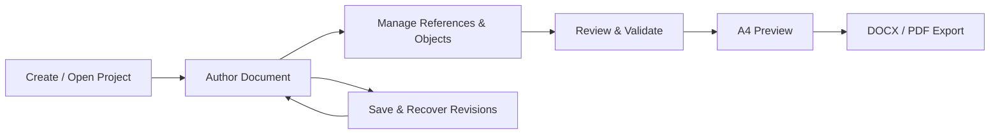

# Xord

**A structured academic writing workspace for Windows.**  
**by Xellen17**

**Language:** [Bahasa Indonesia](README.md) · English

[](https://github.com/zyxel-lyn/Xord/releases/latest)
[](INSTALL.md)
[](https://github.com/zyxel-lyn/Xord/releases)

## What is Xord?

Xord is a **local-first desktop workspace** for creating a structured academic project—from a final-project proposal through its final report—without maintaining separate documents and repeatedly formatting them by hand.

Its initial academic baseline follows D3 Informatics Management, Faculty of Mathematics and Natural Sciences, Universitas Syiah Kuala. Formatting support is profile-specific; Xord does **not** claim automatic compliance with every university's guidelines.

## Capabilities

- **Structured documents:** chapters, subsections, nested headings, appendices, and front matter.
- **Academic editing:** paragraph content, references and citations, figures, tables, and equations.
- **References and evidence:** bibliography import, source-PDF search, evidence notes, and citation usage.
- **Review and validation:** actionable issue locations and export gating for blocking problems.
- **A4 preview:** produced through the document-output workflow.
- **Publishing:** **DOCX and PDF**, with workflow-specific ZIP bundles only where required.
- **Local project data:** a single project file, autosave, revision history, recovery, and integrity checks.
- **Academic lifecycle:** retain project continuity as work moves from proposal to final report.

> **Output contract:** Xord does not offer HTML export. HTML/WebView2 may be used internally by the editor, but is not a user-facing export format.

## Release status

| Track | Status |
| --- | --- |
| Windows x64 public distribution | **v1.1.3 — stable** |
| Xord UI v1.2.0 | **In development and verification** |
| Other operating systems | Not officially distributed |
| Cloud hosting | Not required for local use |

**UI v1.2.0 is not a stable public release yet.** Development previews and screenshots must not be confused with published binaries.

## Download and installation

1. Go to [the latest release](https://github.com/zyxel-lyn/Xord/releases/latest).
2. Download the Windows x64 archive and its **`SHA256SUMS.txt`** manifest.
3. Verify the archive's SHA-256 before extracting it.
4. Extract the archive and follow the bundled installation instructions. Some MSIX releases require installing the public signing certificate using an elevated PowerShell session.
5. Open the installed application from the Start Menu.

Older published packages may still contain historic file names or installer identities from before the Xord rename. These belong to previously released artifacts and do not change the current product name.

**[Installation instructions](INSTALL.md)** · **[Security policy](SECURITY.md)**

### Installer helper

After downloading the repository or the helper, run PowerShell as Administrator:

```powershell
Set-ExecutionPolicy -Scope Process Bypass
.\scripts\Install-Xord.ps1
```

The helper resolves the latest stable release, verifies the archive checksum, extracts it, and invokes the packaged installer. To verify a local archive manually:

```powershell
.\scripts\Verify-Xord.ps1 -ZipPath ".\package-Windows-x64.zip" -ChecksumsPath ".\SHA256SUMS.txt"
```

Replace the example ZIP path with the actual file name. You are encouraged to inspect scripts before execution.

## Product workflow



## Local data and privacy

Xord is designed to keep academic content and project attachments on the user's own machine. Do not attach projects containing personal information to public issues.

Renaming the product must not break the ability to open existing project files or preserve their project identity and revision history.

## About this repository

**`zyxel-lyn/Xord`** currently hosts **public release packages, user documentation, support issues, and installation guidance**. The full production source code, private signing keys, and internal build processes are **not part of the public distribution at this time**.

## Reporting issues

Use [GitHub Issues](https://github.com/zyxel-lyn/Xord/issues) with the application version, Windows version, reproducible steps, expected behavior, and actual behavior. Redact names, IDs, personal documents, and credentials from screenshots or logs.

Please review [SECURITY.md](SECURITY.md) for security-sensitive disclosures.

---

**Xord — structured academic writing, local-first.**  
by Xellen17
