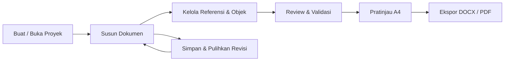

# Xord

**Ruang kerja desktop untuk penulisan akademik yang terstruktur.**  
**by Xellen17**

**Bahasa:** Bahasa Indonesia · [English](README.en.md)

[](https://github.com/zyxel-lyn/Xord/releases/latest)
[](INSTALL.md)
[](https://github.com/zyxel-lyn/Xord/releases)

## Tentang Xord

Xord membantu mahasiswa menyusun **Proposal Proyek Akhir** hingga **Laporan Proyek Akhir** dalam satu proyek lokal. Penulisan tetap berfokus pada substansi, sementara struktur akademik, pratinjau, pemeriksaan, dan proses ekspor dikelola dalam satu aplikasi.

Xord dikembangkan dengan kebutuhan D3 Manajemen Informatika FMIPA Universitas Syiah Kuala sebagai baseline akademik. Implementasi format khusus mengikuti profil akademik yang tersedia; aplikasi tidak otomatis menjamin kesesuaian dengan setiap pedoman perguruan tinggi.

## Fitur utama

- **Dokumen terstruktur:** BAB, subbab, sub-subbab, lampiran, cover, dan halaman awal.
- **Editor akademik:** pengelolaan paragraf, sitasi, gambar, tabel, dan persamaan.
- **Referensi & evidence:** impor bibliografi, penelusuran PDF sumber, catatan evidence, serta pelacakan sitasi.
- **Review & validasi:** pemeriksaan akademik dengan lokasi isu dan pembatas ekspor jika ada masalah kritis.
- **Pratinjau A4:** menggunakan jalur produksi yang terkait dengan dokumen keluaran.
- **Ekspor:** **DOCX dan PDF**; paket ZIP disediakan hanya untuk alur akademik yang memang membutuhkannya.
- **Proyek lokal:** berkas proyek tunggal, autosave, histori revisi, pemulihan, dan pemeriksaan integritas.
- **Workflow akademik:** kelanjutan proposal hingga laporan akhir tanpa membuat proyek terpisah.

> **Batasan:** Xord tidak menyediakan ekspor HTML. HTML/WebView2 dapat digunakan secara internal oleh editor, tetapi bukan format keluaran pengguna.

## Status proyek

| Jalur | Status |
| --- | --- |
| Rilis aplikasi untuk Windows x64 | **v1.1.3 — stabil** |
| Pembaruan antarmuka Xord v1.2.0 | **Dalam pengembangan dan pengujian** |
| Platform lain | Belum menjadi distribusi resmi |
| Hosting/cloud | Tidak diperlukan untuk penggunaan lokal |

**UI v1.2.0 belum diumumkan sebagai rilis stabil.** Jangan menyamakan preview pekerjaan pengembangan dengan paket rilis pada halaman **Releases**.

## Mengunduh dan memasang

1. Buka [Releases terbaru](https://github.com/zyxel-lyn/Xord/releases/latest).
2. Unduh paket Windows x64 dan file **`SHA256SUMS.txt`** pada rilis yang sama.
3. Verifikasi SHA-256 paket sebelum mengekstraknya.
4. Ekstrak paket, kemudian ikuti petunjuk instalasi yang disertakan. Paket MSIX tertentu memerlukan pemasangan sertifikat publik menggunakan PowerShell dengan izin Administrator.
5. Buka aplikasi dari Start Menu.

Beberapa paket rilis historis masih memakai nama berkas atau identitas installer dari sebelum perubahan merek. Nama tersebut merupakan bagian dari artefak rilis yang sudah diterbitkan, bukan nama produk saat ini.

**[Panduan instalasi lengkap](INSTALL.md)** · **[Kebijakan keamanan](SECURITY.md)**

### Instalasi dengan helper

Setelah mengunduh repository atau file helper-nya, jalankan PowerShell sebagai Administrator:

```powershell
Set-ExecutionPolicy -Scope Process Bypass
.\scripts\Install-Xord.ps1
```

Helper akan mengambil rilis stabil terbaru, memverifikasi checksum, lalu menjalankan installer yang ada di paket. Untuk memeriksa ZIP secara manual:

```powershell
.\scripts\Verify-Xord.ps1 -ZipPath ".\paket-Windows-x64.zip" -ChecksumsPath ".\SHA256SUMS.txt"
```

Ganti path ZIP dengan nama file yang benar-benar diunduh. Periksa isi skrip sebelum menjalankannya jika Anda menginginkan instalasi yang sepenuhnya diaudit.

## Alur penggunaan



## Berkas proyek dan privasi

Xord dirancang **local-first**. Dokumen proyek, lampiran dan metadata akademik dikelola di perangkat pengguna. Jangan mengunggah berkas proyek berisi data pribadi ke issue publik.

Berkas proyek dari rilis terdahulu tetap memerlukan dukungan kompatibilitas; perubahan merek tidak boleh digunakan sebagai alasan untuk menghapus data, identitas proyek, atau histori revisi.

## Tentang repository ini

Repository **`zyxel-lyn/Xord`** saat ini merupakan tempat **distribusi rilis, dokumentasi, laporan masalah dan panduan penggunaan publik**. Source pengembangan penuh, material penandatanganan privat, dan proses build internal **tidak termasuk** dalam distribusi publik saat ini.

## Bantuan dan kontribusi

Jika menemukan masalah, gunakan [GitHub Issues](https://github.com/zyxel-lyn/Xord/issues) dengan versi aplikasi, versi Windows, langkah reproduksi, hasil yang diharapkan, dan hasil yang terjadi. Hapus nama, nomor identitas, isi dokumen pribadi dan kredensial sebelum mengunggah tangkapan layar/log.

Untuk masalah keamanan, baca [SECURITY.md](SECURITY.md).

---

**Xord — structured academic writing, local-first.**  
by Xellen17
